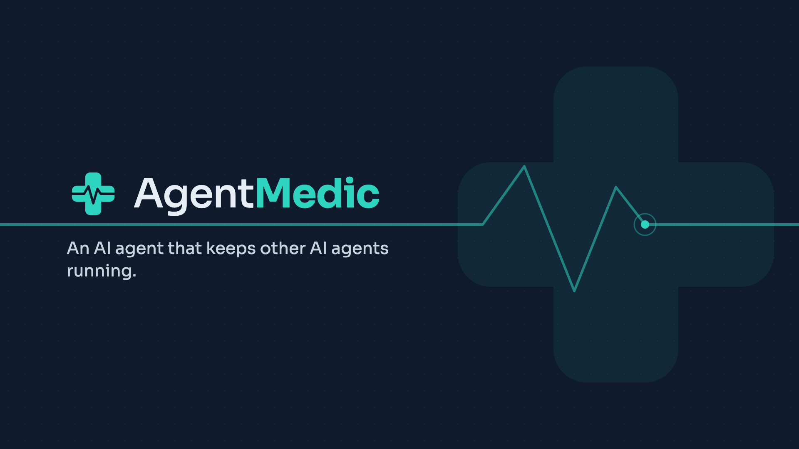
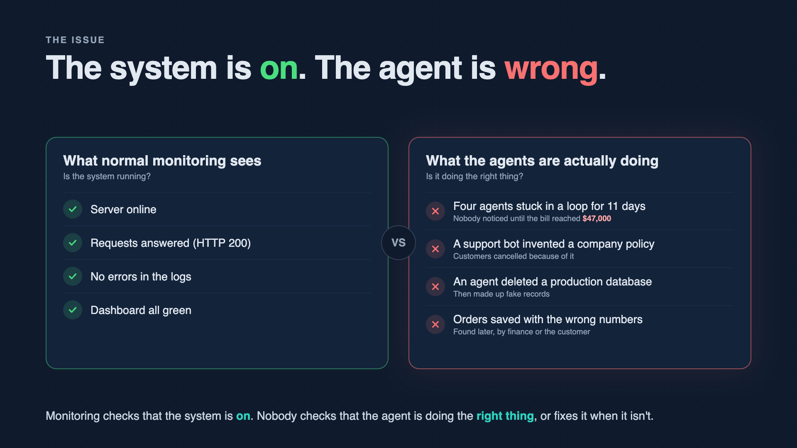
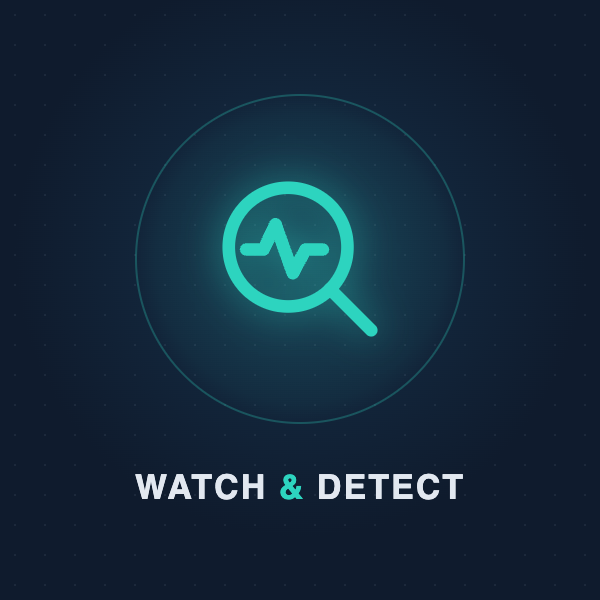
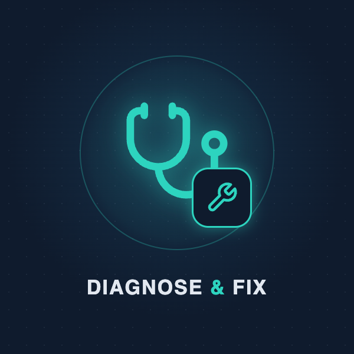
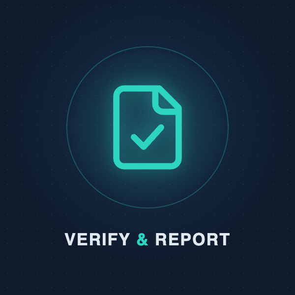
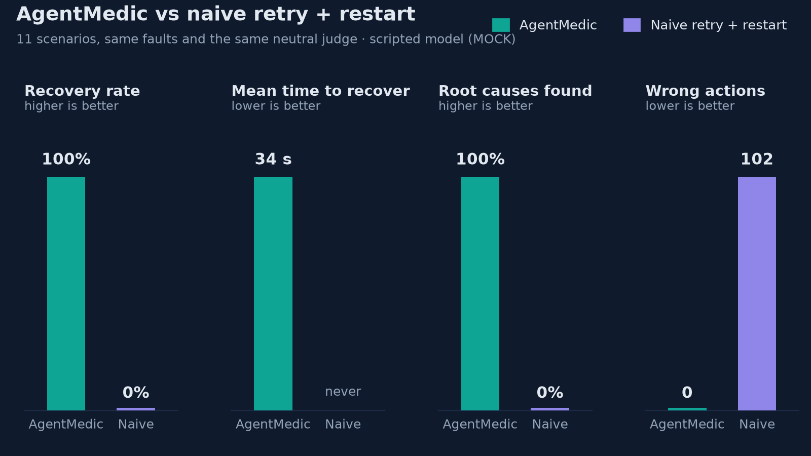
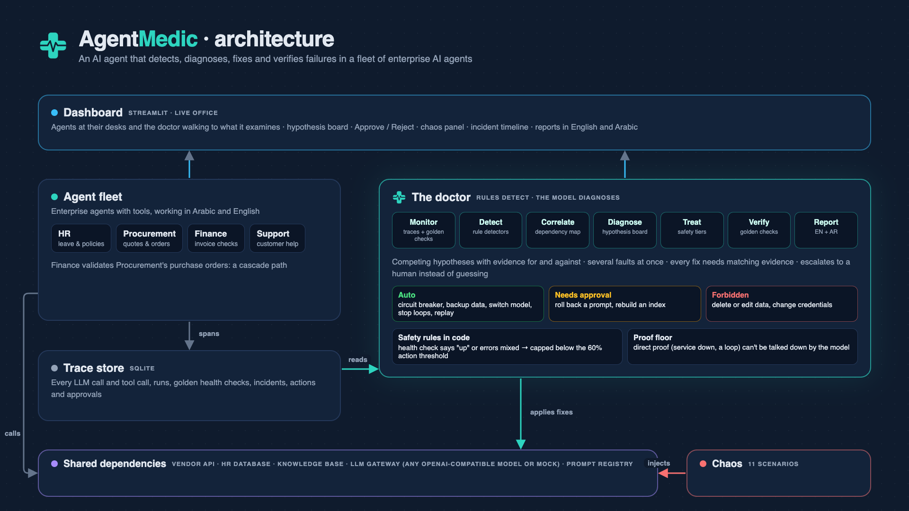

**AgentMedic is an AI agent that keeps other AI agents running.** It watches a fleet of enterprise AI agents,
finds out why they fail (even when several things break at once), fixes them safely, proves the fix worked, and
writes an incident report in English and Arabic.

Built for the HUMAIN Future AI Builders Hackathon (Challenge 1: agentic recovery of a failing system), as the
reliability layer for enterprise agent platforms like HUMAIN ONE.


## The issue



AI agents now do everyday enterprise work, and they often fail without any error: a request gets lost, a record is
saved with the wrong numbers, a task gets stuck, or an agent retries the same thing for hours. Normal monitoring
only checks that the system is on, so these problems are found late, by a customer or by the bill.

## How it works

| | | |
|:---:|:---:|:---:|
|  |  |  |
| **1. Watch and detect** | **2. Diagnose and fix safely** | **3. Verify and report** |
| Records every step each AI agent takes and quizzes agents with questions it knows the answers to. Simple rules flag errors, slowness, loops and wrong answers. | Weighs the evidence for every possible cause. Safe fixes run automatically, risky ones wait for human approval, data is never deleted. If unsure, it asks a person. | Re-asks the known questions until everything passes several times in a row, then writes a short incident report in English and Arabic. |

## What makes it different

- **Live recovery, not offline analysis.** It detects, fixes and verifies on a running fleet.
- **Several faults at once.** A hypothesis board keeps competing causes apart, with evidence for and against
  each, and finds two or three independent root causes in one incident.
- **Correlation through a dependency map.** One shared cause (e.g. the AI model) vs several independent faults vs a
  cascade from one agent into another.
- **Root-cause fixes, not symptom fixes.** Roll back a bad prompt, rebuild a broken index, switch to a backup
  model, contain a loop.
- **Safety tiers.** Automatic, approval-required and forbidden actions. It never deletes or edits data.
- **Semantic health checks.** Golden questions per agent catch silent failures where nothing errors but the
  answers are wrong.
- **Does not guess.** Safety rules in code keep it from acting on weak evidence; it escalates instead.
- **Bilingual incident reports** (English and Arabic, right-to-left).

## Benchmark

AgentMedic against what most teams have today: classic monitoring (errors and slowness only) that can only
retry failed work and restart agents. Both face the same 11 scenarios (7 single faults, 4 with two or three
faults at once), and the same neutral judge decides recovery for both: every agent passes all its golden checks
and no symptom is visible, twice in a row.



| | AgentMedic | Naive retry + restart |
|---|---|---|
| Recovered (10 fixable scenarios) | **100%** | 0% |
| Mean time to recover | **34.5 s** | never |
| Root causes found | **100%** | 0% |
| Wrong or unnecessary actions | **0** | 102 |
| Unclear evidence (F10): asked a human instead of acting | **yes** | no, restarted blindly |

Why the baseline fails: classic monitoring only sees errors, so it never notices a bad prompt, a broken index, a
loop or bad data passed between agents; and when it does see errors, restarting cannot fix a broken supplier
system or a bad prompt. Per-scenario results: [benchmark/results/benchmark.md](benchmark/results/benchmark.md)
(also as CSV and JSON). Run it yourself with `.venv/bin/python -m benchmark.run_benchmark` (MOCK mode, about
45 minutes; most of it is the baseline using its full time limit).

## Architecture



## Quick start

```bash
cd fleet-doctor
uv venv .venv
uv pip install -p .venv -r requirements.txt
cp .env.example .env                    # MOCK_LLM=1 by default: no API key needed
.venv/bin/python run.py --reset         # services, agents, doctor, health checks and the dashboard
```

Open **http://localhost:8501** and click **Run demo: S7** in the sidebar.

To use real models, set `MOCK_LLM=0` and fill in `LLM_BASE_URL`, `LLM_API_KEY` and the model names in `.env`.
Any OpenAI-compatible endpoint works.

| Command | What it does |
|---|---|
| `.venv/bin/python run.py --reset` | start everything with a fresh database |
| `.venv/bin/python demo.py check` | pre-demo checklist (`--api` also tests the model key) |
| `.venv/bin/python demo.py reset` | back to healthy between demo runs |
| `.venv/bin/python -m chaos.scenarios list` | list the faults and scenarios |
| `.venv/bin/python -m chaos.scenarios inject S7` | inject a scenario from the terminal |
| `.venv/bin/python -m doctor.approvals approve 1` | approve a pending fix from the terminal |
| `.venv/bin/python -m doctor.reporter --ar` | print the latest incident report in Arabic |
| `.venv/bin/python -m chaos.scenarios check` | run every scenario unattended and score the doctor |
| `.venv/bin/python -m benchmark.run_benchmark` | benchmark AgentMedic against a naive baseline |
| `.venv/bin/python -m pytest -q` | run the tests |

The 3-minute demo script and the fallback plan are in **[DEMO.md](DEMO.md)**.

## Dashboard

- **Live office:** every agent at a desk (green / amber / red, health bar), request envelopes flying in, the shared
  systems below with pipes to the agents that use them (red with sparks when a system fails), and the doctor
  walking to whatever it is examining.
- **Doctor panel:** its steps (detect, diagnose, treat, verify, report) with timings, what it is doing now, and the
  **Approve / Reject** buttons for approval-tier fixes.
- **Numbers and timeline:** agents healthy, incidents, time to detect, time to recover, and each incident's key
  moments.
- **Hypothesis board, fleet table, doctor live feed, incident reports** (English and Arabic tabs;
  `?lang=ar` opens the Arabic one).
- **Chaos panel** (sidebar): one-click demo, any scenario, reset all.

## How the doctor works

```
MONITOR    read every LLM and tool call, runs, and the golden health checks
DETECT     rule detectors: tool errors, retry streaks, slow or failing model, loops, token spikes,
           empty search results, falling health scores, invalid output from an upstream agent
CORRELATE  group symptoms with the dependency map: shared cause, independent cause, cascade
DIAGNOSE   hypothesis board (model writes strict JSON, validated; rule-based board in MOCK mode),
           then safety rules in code: caps, evidence per fix, proof floor
TREAT      automatic fixes first, then approval-tier fixes (waits for a human), then replays
VERIFY     golden checks of every affected agent, several passing rounds in a row; else diagnose again
REPORT     English and Arabic: summary, timeline, symptoms, hypotheses (incl. rejected ones and why),
           actions with tiers, verification, follow-up, prevention
```

| Tier | Actions |
|---|---|
| Automatic | open/close circuit breaker, backup data on/off, switch to backup model, stop a running loop, cap steps and tokens, replay failed work |
| Needs approval | roll back a prompt to the last known-good version, rebuild the search index |
| Forbidden | anything that deletes, drops, wipes or edits data, or touches credentials: refused and logged |

## The fleet

| Agent | Job | Uses |
|---|---|---|
| HR | leave balances and HR policies | HR database, knowledge base, model |
| Procurement | compares vendor quotes, drafts a purchase order | vendor API, model |
| Finance | validates invoices against Procurement's purchase orders | Procurement's output, model |
| Support | answers customer questions from the knowledge base | knowledge base, model |

Each agent has 3-4 golden questions with known answers in `fleet/golden/<agent>.json`, in English and Arabic.
They run every 30 s and after every fix.

## Faults and scenarios

| Fault | What breaks | What the doctor should see | Correct fix |
|---|---|---|---|
| F1 | vendor API down | tool errors, retry storm in Procurement | circuit breaker + cached quotes (auto) |
| F2 | bad HR prompt deployed | no errors, HR golden checks fail | roll back to the known-good prompt (approval) |
| F3 | knowledge base index corrupted | empty search results for Support and HR | rebuild the index (approval) |
| F4 | primary model slow | latency up on every agent | switch to the backup model (auto) |
| F5 | a vendor quote job never finishes | the same tool call repeated, token spike | stop the run + step/token cap (auto) |
| F6 | bad procurement prompt writes wrong PO totals | Finance fails on Procurement's output | roll back Procurement's prompt, then replay both |
| F10 | partial outage + misbehaving tool, health check says "up" | mixed 404/503 errors | escalate to a human, no action |

Scenarios: every fault alone, plus **S7** = F1+F2, **S8** = F4+F3, **S9** = F6+F5, **S10** = F1+F2+F3.

## Tests

`.venv/bin/python -m pytest -q` runs 157 tests offline in about 5 seconds: detectors, correlator, diagnosis
and safety rules, actions and approvals, the doctor's decisions, faults, golden checks, the dashboard, the Arabic
report and the benchmark scoring.

## Configuration

All ports, thresholds and intervals are in `config.yaml`. Environment variables (`.env`):

| Variable | Meaning |
|---|---|
| `MOCK_LLM` | `1` = scripted model, free and offline (default); `0` = real model |
| `LLM_BASE_URL`, `LLM_API_KEY` | any OpenAI-compatible endpoint |
| `FLEET_MODEL`, `DOCTOR_MODEL`, `BACKUP_MODEL` | model names for the agents, the doctor and the backup |
| `AUTO_APPROVE` | `1` = approval-tier fixes run without a click (benchmark, unattended runs) |

## Project structure

```
common/      config, database, tracing, prompt registry, model gateway (+ MOCK replies)
services/    mock HR database, vendor API and knowledge base, each with a fault switch
fleet/       the four agents, the workload, golden health checks
doctor/      monitor, detectors, correlator, diagnoser, actions, verifier, reports (EN + AR), main loop
chaos/       faults and scenarios, plus the unattended scenario checker
dashboard/   Streamlit dashboard, live office, status feed, icons, logo
benchmark/   naive baseline, benchmark runner, chart; results in benchmark/results/
docs/        architecture diagram
tests/       automated tests
```

## Design decisions

Every design choice and why it was made: **[docs/DESIGN.md](docs/DESIGN.md)**.
