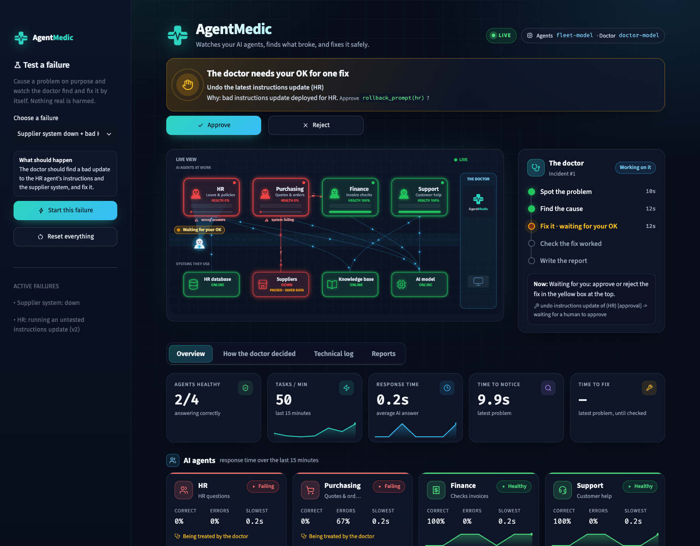
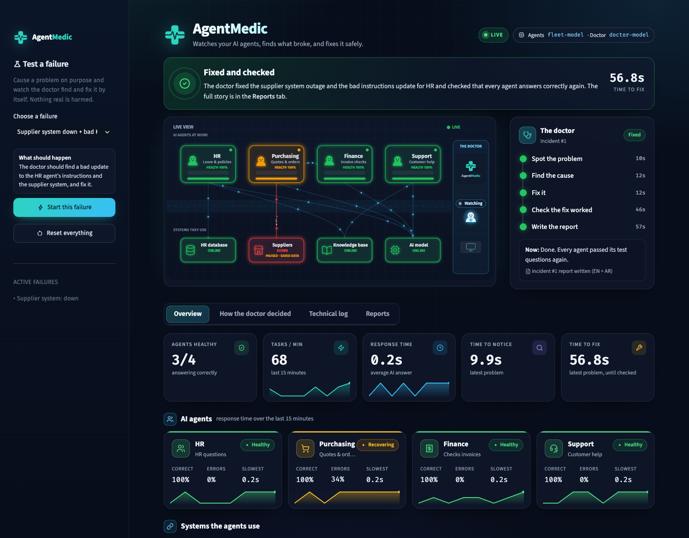

# AgentMedic

**An AI agent that keeps other AI agents running.**

Companies now use AI agents for everyday work like HR requests, purchasing and finance. These agents often fail
without any error: a request gets lost, a record is saved with the wrong numbers, a task gets stuck, or an agent
retries the same thing for hours. Normal monitoring only checks that the system is on, not that the agent is doing
the right thing.

AgentMedic watches a fleet of AI agents and the systems they depend on. When something goes wrong, it finds the
cause, fixes it safely, proves the fix worked, and writes a short incident report in English and Arabic.

Built for the HUMAIN Future AI Builders Hackathon (Challenge 1: agentic recovery of a failing system).

## How it works

1. **Watch and detect.** AgentMedic records every step each agent takes and regularly asks each agent questions it
   already knows the answers to. Simple rules flag errors, slowness, loops, wrong answers and bad data passed
   between agents.
2. **Diagnose and fix safely.** It lists the possible causes, weighs the evidence for and against each one, and can
   find several causes at once. Safe fixes run automatically, risky fixes wait for a person to approve, and deleting
   or changing data is never allowed. If it isn't sure, it hands the problem to a person instead of guessing.
3. **Verify and report.** It asks the known questions again until everything passes several times in a row, then
   writes an incident report in English and Arabic.

## Screenshots

Two failures at once: the supplier system goes down and a bad update reaches the HR agent. The doctor finds both
causes, fixes what is safe on its own, and asks a person before the risky fix:



After approval: the fixes are checked and the report is written. Purchasing keeps working on saved backup prices
until the supplier system is back:



## What makes it different

- Fixes problems on a live system instead of only analysing them afterwards.
- Handles several failures at the same time and explains why it rejected the other causes.
- Catches silent failures, where nothing errors but the answers are wrong.
- Fixes the root cause (for example, undoing a bad update) instead of just restarting.
- Never deletes data, asks before risky fixes, and escalates when the evidence is unclear.

## Results

Tested on 11 failure scenarios, including 2 and 3 failures at once, against classic "retry and restart" monitoring:

| | AgentMedic | Retry and restart |
|---|---|---|
| Recovered | 100% | 0% |
| Root causes found | 100% | 0% |
| Wrong actions | 0 | 102 |
| Average time to recover | 34.5 s | never |

These runs used scripted AI replies, so every run behaves the same and the comparison is fair. Details:
[benchmark/results/benchmark.md](benchmark/results/benchmark.md)

## Quick start

Needs Python 3.10 or newer and an AI model that supports tool calling. Use whichever provider you have.

```bash
git clone https://github.com/YousefAldali/AgentMedic.git
cd AgentMedic
uv venv .venv
uv pip install -p .venv -r requirements.txt
cp .env.example .env              # then pick your AI provider and model (see below)
.venv/bin/python run.py --check --api   # checks the setup and the AI model
.venv/bin/python run.py --reset   # starts the agents, the doctor and the dashboard
```

Open http://localhost:8501, pick a failure under **Test a failure** in the sidebar and click **Start this failure**.
AgentMedic calls your AI model all the time while it runs, so stop it (Ctrl+C) when you are done.

### Choosing an AI provider

Set `LLM_PROVIDER` in `.env` and add your key and model name:

| Provider | `LLM_PROVIDER` | Key needed |
|---|---|---|
| OpenAI | `openai` | yes |
| Google Gemini | `gemini` | yes |
| Groq | `groq` | yes |
| Mistral | `mistral` | yes |
| OpenRouter (many models behind one key) | `openrouter` | yes |
| DeepSeek | `deepseek` | yes |
| Together AI | `together` | yes |
| xAI | `xai` | yes |
| Azure OpenAI (also set `LLM_BASE_URL` to your endpoint) | `azure` | yes |
| Ollama, on your own computer | `ollama` | no, free |
| LM Studio, on your own computer | `lmstudio` | no, free |
| Anything else that speaks the OpenAI API | leave empty, set `LLM_BASE_URL` | depends |

For example, to try it for free with [Ollama](https://ollama.com):

```bash
LLM_PROVIDER=ollama
FLEET_MODEL=llama3.1
```

`DOCTOR_MODEL` (the model the doctor thinks with) and `BACKUP_MODEL` (used when the main model is slow) are
optional and fall back to `FLEET_MODEL`.

Run the tests with `.venv/bin/python -m pytest -q` (no API key needed: the tests use scripted AI replies).

## Project structure

```
fleet/       the AI agents (HR, procurement, finance, support) and their health checks
doctor/      AgentMedic: detect, diagnose, fix, verify, report
services/    the systems the agents depend on, with switches to break them on purpose
chaos/       failure scenarios for testing
dashboard/   the live dashboard (style.css for the look, names.py for the plain names it shows)
benchmark/   comparison with retry-and-restart monitoring
tests/       automated tests
```

More: [design decisions](docs/DESIGN.md)
